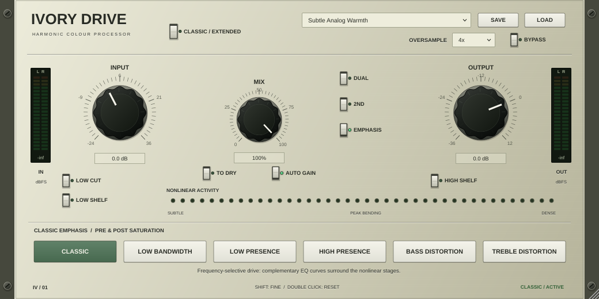

# Ivory Drive

A native C++20 / JUCE harmonic saturation effect for **Windows 11 x64 VST3**.
This is an independent implementation inspired by the documented pre/post
emphasis workflow of the Overstayer M-A-S. It includes original DSP and vector
rack artwork; no proprietary code, artwork, or branding is distributed.



[Extended interface](Docs/ValidationArtifacts/IvoryDrive-Extended.png)

## Processing

- Classic and Extended interfaces share the nonlinear engine.
- Two calibrated soft-knee stages, residual feedback, Dual and 2ND controls.
- Six different pre/post emphasis profiles; four configurable Extended bands
  with independent pre/post gain or complementary compensation.
- Resonant high/low-pass filters, input shelves, drive, auto compensation,
  dry gain, wet/dry mix and output gain.
- Selectable high-quality 2x/4x/8x oversampling, fixed reported latency and
  aligned dry and bypass paths; smooth quality transitions.
- Mono/stereo, float/double, automatable controls, versioned host state,
  12 factory presets and XML user presets.
- Scalable original ivory rack interface with live stereo levels and
  nonlinear activity metering.

The nonlinear transfer and emphasis curves are independent engineering
choices. No measured 1:1 sonic match to the reference hardware or commercial
plug-in is claimed. See [the technical specification](Docs/TechnicalSpecification.md)
and [DSP design](Docs/DSP.md) for the documented controls and assumptions.

## Build the Windows plug-in

Install Visual Studio 2022 with **Desktop development with C++**, a Windows
SDK, Git, and CMake 3.22 or newer. In an x64 Developer PowerShell:

```powershell
git clone https://github.com/deemarbus/overstayer.git
cd overstayer
cmake --preset windows-vs2022
cmake --build --preset windows-release
ctest --preset windows-release
```

JUCE 8.0.10 is fetched at an exact commit. To use an existing checkout, add
`-DIVORY_JUCE_PATH=C:/path/to/JUCE` to the configure command.

The resulting bundle is:

```text
Builds/Windows/IvoryDrive_artefacts/Release/VST3/Ivory Drive.vst3/
```

Copy the **entire bundle directory** into
`C:\Program Files\Common Files\VST3\` (administrator rights may be required),
then rescan plug-ins in Ableton Live. Do not move only the inner binary.

The [Windows build workflow](.github/workflows/windows.yml) runs MSVC builds
and tests on pushes to `main` and uploads `IvoryDrive-Windows-x64`. Extract
that artifact's ZIP to obtain the bundle and documentation. A workflow
definition alone is not evidence that the Windows build or Ableton test passed.

## Validate the DSP on this cloud machine

The cloud machine is Linux; its builds are development validation, not a
Windows release. No Linux product is required or distributed.

```sh
bash Scripts/setup-cloud.sh
source /workspace/.tools/activate-ivory.sh
cmake --preset dsp-only
cmake --build --preset dsp-tests
ctest --preset dsp-tests
python3 Tools/analyze.py --help
```

The independent suite performs harmonic/THD, emphasis, filter, transient,
stereo, gain, silence, extreme-level, modulation and performance checks. Its
CSV and WAV output is written under the test working directory's `validation/`.
The JUCE processor integration suite additionally checks real oversampling,
dry/wet latency, both bypass paths, float/double mono/stereo at five rates,
all factory presets, host/user recall and editor rendering.

See [validation](Docs/Validation.md) for actual measured results and their
scope. Optional reference comparison accepts user-supplied, licensed renders;
no reference recordings are included.

## Use

Start with a factory preset, then adjust INPUT to drive the circuit. AUTO GAIN
removes the corresponding linear input gain from the wet output; it is not a
perceptual loudness matcher. TO DRY applies input gain to the dry branch.
MIX blends the latency-aligned branches and OUTPUT follows the blend.

Classic's six selections change the signal **before and after** saturation.
In Extended, PRE drives each frequency band into the circuit. COMP makes POST
the complementary negative gain; disable COMP to edit POST independently.
EMPHASIS disables Extended EQ and its adjustable filters. The common white
input filter/shelf switches remain separate controls.

Double-click a knob to reset it, hold Shift for fine movement, use the wheel
or type into its value box. The editor resizes with a fixed aspect ratio for
each mode. SAVE and LOAD manage user XML presets; DAW projects store the full
state without an external preset file.

## Licensing and release status

Original source is MIT. JUCE and its bundled VST3 SDK have separate terms;
read [third-party notices](Docs/ThirdParty.md) before distributing a binary.
See [release checks](Docs/ReleaseChecklist.md) for the remaining Windows host,
Ableton, listening and reference-calibration checks. Treat the initial build
as a release candidate until those platform checks have been performed.
